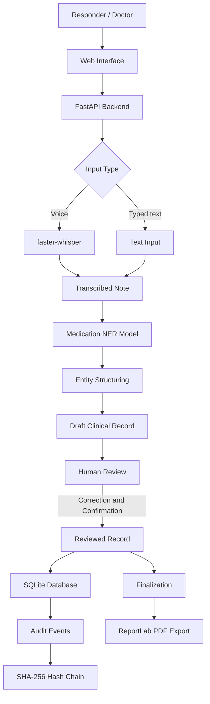

# Field-to-Record 🩺

### Voice-to-Structured Clinical Note Generator

Field-to-Record converts spoken or typed field notes into structured clinical documentation. It uses speech recognition and medication-related named entity recognition (NER) to organize information about medications, dosages, routes, and procedures mentioned by a responder.

The system generates a **draft record for human review**. A doctor or authorized healthcare professional can review, correct, and confirm the extracted information before the record is finalized and exported.

> **Core principle:** Capture what the responder said, structure it clearly, and keep the healthcare professional in control.

---

## Problem Statement

During emergency response and field care, important details about medications and procedures may be communicated verbally or recorded as unstructured notes. Turning these notes into consistent documentation can take time and may make later review more difficult.

Field-to-Record aims to simplify this process by transforming field notes into structured, timestamped records while preserving a human review step.

## Key Features

- **Voice and text input:** Capture responder notes through microphone recording or typed text.
- **Speech-to-text:** Use local speech recognition to transcribe recorded audio.
- **Medication entity extraction:** Identify medication-related information using a pretrained clinical NER model.
- **Structured draft generation:** Organize extracted information into a consistent record format.
- **Human-in-the-loop review:** Allow the healthcare professional to review and correct extracted details before finalization.
- **Record history:** Store records and track their review status and timestamps.
- **PDF export:** Generate a formatted PDF for eligible finalized records.
- **Audit trail:** Link recorded workflow events using a SHA-256 hash chain to help detect changes to the audit history.
- **Local-first processing:** Support local speech recognition and local data storage.

## System Architecture



## How It Works

1. **Capture:** The responder records a voice note or enters text.
2. **Transcribe:** For audio input, faster-whisper converts speech into text.
3. **Extract:** A pretrained medication NER model identifies relevant medication entities.
4. **Structure:** Python code organizes the extracted information into a draft record.
5. **Review:** The healthcare professional checks the original note and extracted fields, correcting errors where necessary.
6. **Finalize:** The application allows finalization only after the required review and confirmation steps.
7. **Export:** An eligible finalized record can be exported as a PDF.
8. **Audit:** Workflow events are recorded in a hash-linked audit trail.

## Tech Stack

| Component | Technology | Purpose |
|---|---|---|
| Backend | Python, FastAPI | API routes and application workflow |
| Frontend | HTML, CSS, JavaScript | User interface and microphone interaction |
| Templates | Jinja2 | Dynamic pages and record rendering |
| Speech recognition | faster-whisper | Local audio transcription |
| NLP / NER | Hugging Face Transformers | Medication-related entity extraction |
| Pretrained model | `genzeonplatform/healthcare-brain-medication-ner` | Extract medication-related entities |
| Data validation | Pydantic | Structured data validation where used |
| Database | SQLite | Local record storage |
| Audit trail | Python, SHA-256 | Hash-linked audit events |
| PDF generation | ReportLab | Formatted document export |
| Testing | pytest | Automated tests |

## Pretrained NER Model

Field-to-Record uses the pretrained model:

[`genzeonplatform/healthcare-brain-medication-ner`](https://huggingface.co/genzeonplatform/healthcare-brain-medication-ner)

The model is based on Bio_ClinicalBERT and performs token classification for medication-related entities.

The model's output is used as an extraction aid. Entity extraction can produce fragmented, missing, or incorrectly classified results, so the application retains a human review step rather than treating model output as verified clinical information.

## Project Structure

```text
Field-to-Record/
├── app/
│   ├── main.py           # FastAPI routes and application entry point
│   ├── ner.py            # Pretrained medication NER integration
│   ├── structure.py      # Converts extracted entities into draft records
│   ├── speech.py         # Local speech-to-text integration
│   ├── database.py       # SQLite persistence
│   ├── audit.py          # Hash-linked audit events
│   └── finalize.py       # Review and finalization workflow
│
├── templates/
│   ├── base.html         # Shared layout and styling
│   ├── index.html        # Voice and text input
│   ├── review.html       # Draft review and correction
│   ├── history.html      # Previously captured records
│   └── record_detail.html # Individual record details
│
├── data/
│   ├── generate_synthetic.py  # Synthetic example generator
│   ├── synthetic.jsonl        # Generated test examples
│   └── field_to_record.db     # Local SQLite database
│
├── tests/                # Automated tests, as developed
├── requirements.txt
└── README.md
```

*The tree reflects the current project layout discussed during development. Adjust it if your actual repository differs. Do not commit your local database or sensitive recordings.*

## Getting Started

### Prerequisites

- Python 3.11
- Git
- Internet access for installing dependencies and downloading the pretrained model on first use
- A microphone for testing voice input

### 1. Clone the repository

```bash
git clone https://github.com/<your-username>/Field-to-Record.git
cd Field-to-Record
```

Replace `<your-username>` with your GitHub username and use your repository's exact URL.

### 2. Create a virtual environment

**Windows PowerShell**

```powershell
python -m venv .venv
.\.venv\Scripts\Activate.ps1
```

If PowerShell blocks activation, you can run the environment's Python directly or use Command Prompt to activate it.

### 3. Install dependencies

```bash
pip install -r requirements.txt
```

### 4. Run the application

```bash
uvicorn app.main:app --reload
```

Open the application at:

- Web interface: http://127.0.0.1:8000
- FastAPI interactive documentation: http://127.0.0.1:8000/docs

The speech recognition and NER models may need to download their model files the first time they are used. After downloading, local execution depends on the model files and configuration being available.

## Synthetic Data

The project includes generated synthetic examples for experimenting with the extraction and structuring pipeline.

Synthetic data can help with:

- Testing the application's input and output flow
- Checking how entity spans are represented
- Testing formatting and record structuring
- Building repeatable software tests

**Synthetic examples are not clinically verified training data.** Generating examples does not improve the pretrained model's accuracy unless an appropriate training or fine-tuning process is implemented and evaluated.

## Safety and Scope

Field-to-Record is a documentation assistance tool, not a clinical decision-making system.

- It does not recommend medications or procedures.
- It does not independently determine whether a medication or dosage is clinically appropriate.
- Extracted information must not be assumed correct simply because it came from an NLP model.
- The healthcare professional is responsible for reviewing and correcting the draft.
- Only records that meet the application's review requirements should be finalized or exported.

## Privacy and Security Considerations

The project is designed for local development and uses SQLite for local record storage. Local processing can reduce reliance on external services, but it does not by itself guarantee privacy or regulatory compliance.

For development and demonstrations:

- Use synthetic or appropriately de-identified data.
- Do not upload real patient information to public repositories.
- Keep local databases, recordings, environment files, and credentials out of Git.
- Restrict access to stored records and generated documents.
- Treat the SHA-256 audit chain as a tamper-evidence mechanism, not a guarantee that the entire application or database cannot be altered.

The project has not been represented as clinically validated or compliant with a healthcare regulatory framework.

## Current Limitations

- NER extraction may miss or misclassify medication entities.
- Speech recognition quality depends on audio clarity, accents, background noise, and terminology.
- Synthetic examples are intended for software testing, not proof of clinical accuracy.
- Human review remains necessary before finalization.
- Production deployment would require additional privacy, access-control, audit integrity, reliability, and clinical evaluation work.

## Future Improvements

- Evaluate extraction quality using a suitable, de-identified annotated dataset.
- Add automated tests for record creation, corrections, review status, and PDF export.
- Improve handling of fragmented entities and long transcription inputs.
- Add stronger authentication and access controls.
- Improve audit-log integrity and verification.
- Evaluate transcription and extraction performance on representative test cases.

## License

Add a license file before distributing the project publicly. Confirm the licensing terms of the pretrained model and all dependencies before redistribution.

---

**Field-to-Record** — From field notes to structured records, with human review at the center.
